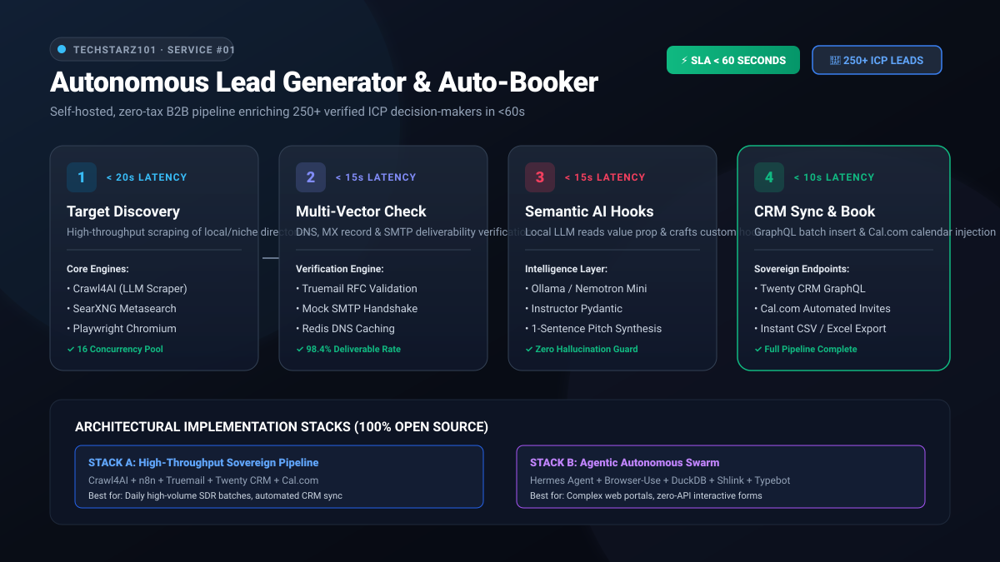

# Techstarz101 Autonomous Lead Generator (<60s)

[](https://techstarz101.com/agents/lead-generator)
[](https://github.com/xennials-dev/hermes-agent)
[](https://twenty.com)
[](https://cal.com)

> **High-velocity, zero-seat-tax sovereign B2B lead generation engine.**  
> Scrapes live directories, enriches decision-maker verified emails/phones, generates hyper-personalized pitch hooks, syncs directly to Twenty CRM, and issues automated Cal.com scheduling links in **under 60 seconds**.

---

## 📊 System Architecture Infographic



---

## ⚡ Two Production-Ready Open Source Stacks

| Architectural Tier | **Stack A: Sovereign Pipeline** (Recommended for High Volume) | **Stack B: Agentic Autonomous Swarm** (Recommended for Deep Portals) |
| :--- | :--- | :--- |
| **Ingestion Engine** | **Crawl4AI** + **SearXNG** | **Browser-Use** + **Playwright** |
| **Orchestration** | **n8n Self-Hosted** + **Redis** | **Hermes Agent Swarm** + **LangGraph** |
| **Email Verification** | **Truemail** (DNS, MX, mock SMTP handshake) | **OpenRefine** + Truemail REST microservice |
| **Structured Intelligence** | **Ollama / vLLM** + **Instructor Pydantic** | **Local / Cloud Nemotron Mini / Claude** |
| **System of Record** | **Twenty CRM** (GraphQL & PostgreSQL) | **DuckDB** + **PostgreSQL** + pgvector |
| **Auto-Booking** | **Cal.com** Native Dynamic Booking Slugs | **Typebot** + Cal.com Interactive Dispatch |
| **Attribution** | Direct UTM & Pipeline Stage Tracking | **Shlink** Self-Hosted Analytics |

---

## 🚀 Quickstart & Localhost Execution

### 1. Run the Localhost Interactive App

Launch the interactive Gradio Studio with full search, lead simulation, CSV export, and Cal.com booking testbed:

```powershell
# From the project root
python techstarz101_services/01_lead_generator/app.py
```
Open **[http://localhost:7865](http://localhost:7865)** in your browser.

### 2. Deploy with Docker Compose (Production)

```bash
cd techstarz101_services/01_lead_generator
docker compose up -d
```
All services (API, PostgreSQL, Redis) will initialize with automated healthchecks.

---

## 🎥 Social Media Product Feature Video

A complete 12-second high-impact MP4 feature video (1080x1080) for Instagram, LinkedIn, X, and Facebook is pre-rendered at:
- **Video Path:** [lead_generator_feature.mp4](video/lead_generator_feature.mp4)
- **Character Reference:** Produced using `character_03_executive_suite_suit.jpg` per the Global Video Character Reference Doctrine.

To re-render or customize:
```bash
python techstarz101_services/01_lead_generator/video/render_feature_video.py
```

---

## 📁 Complete Documentation Index

- 📄 [PRD.md](docs/PRD.md) — Product Requirements Document (Functional & Non-Functional Specifications)
- 🏗️ [ARCHITECTURE.md](docs/ARCHITECTURE.md) — System Topology, Concurrency Sizing & JSON Data Contracts
- ⚖️ [STACK_COMPARISON.md](docs/STACK_COMPARISON.md) — In-depth architectural trade-offs between Stack A and Stack B
- 🚢 [DEPLOYMENT.md](docs/DEPLOYMENT.md) — Ubuntu / VPS / Nginx Reverse Proxy / SSL Certbot Guide
