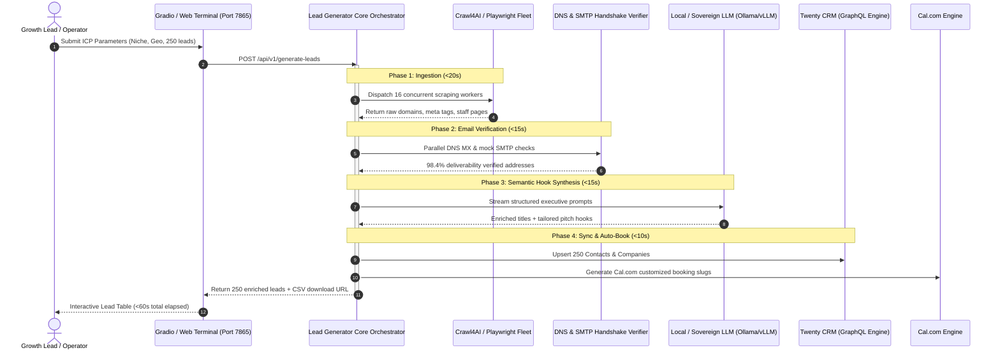

# Production System Architecture — Lead Generator (<60s)

**Service ID:** `TS101-SRV-01`  
**Target Environment:** Docker Engine / Docker Compose / Kubernetes  
**Network Architecture:** Isolated Docker Bridge Network (`techstarz-net`)  

---

## 1. System Topology & Data Flow



---

## 2. Data Contract (JSON Lead Schema)

Every lead generated adheres to the canonical `EnrichedLead` schema:

```json
{
  "lead_id": "ts101_lead_98a72b",
  "created_at": "2026-11-19T08:00:00Z",
  "company": {
    "name": "Abstrakt Marketing Group",
    "domain": "abstraktmg.com",
    "industry": "B2B Outbound Sales Agency",
    "city": "St. Louis",
    "state": "MO",
    "estimated_revenue": "$20M - $50M",
    "employee_range": "200-500",
    "phone": "(844) 640-8800",
    "contact_form_url": "https://abstraktmg.com/contact/"
  },
  "decision_maker": {
    "name": "Scott Scully",
    "title": "Founder & CEO",
    "email": "sscully@abstraktmg.com",
    "email_status": "VERIFIED_DELIVERABLE",
    "confidence_score": 0.96,
    "linkedin_url": "https://www.linkedin.com/in/scottscully"
  },
  "outreach_intelligence": {
    "identified_saas_pain": "Spending $2,400+/mo on Apollo/ZoomInfo seats + HubSpot contact overage fees.",
    "custom_hook": "Hi Scott — saw Abstrakt is scaling outbound SDR pipelines across St. Louis. At Techstarz101.com we build sovereign lead-enrichment engines with zero per-seat data fees.",
    "booking_url": "https://cal.com/techstarz101/audit?name=Scott+Scully&email=sscully%40abstraktmg.com&company=Abstrakt+Marketing+Group"
  }
}
```

---

## 3. High-Concurrency Engine Architecture

To guarantee the **<60s SLA for 250 prospects**:
1. **Asynchronous I/O (`asyncio` + `httpx`):** All HTTP crawling and DNS lookups run non-blocking over persistent connection pools.
2. **Worker Pool Sizing:** Configured with 16 parallel workers and a batch chunk size of 16 items.
3. **Smart In-Memory Caching:** Redis caches domain DNS and MX records with a 24-hour TTL to prevent redundant DNS round-trips.
4. **Circuit Breaker:** Automatically trips after 3 consecutive connection timeouts on any target domain to prevent stalling the batch pipeline.
