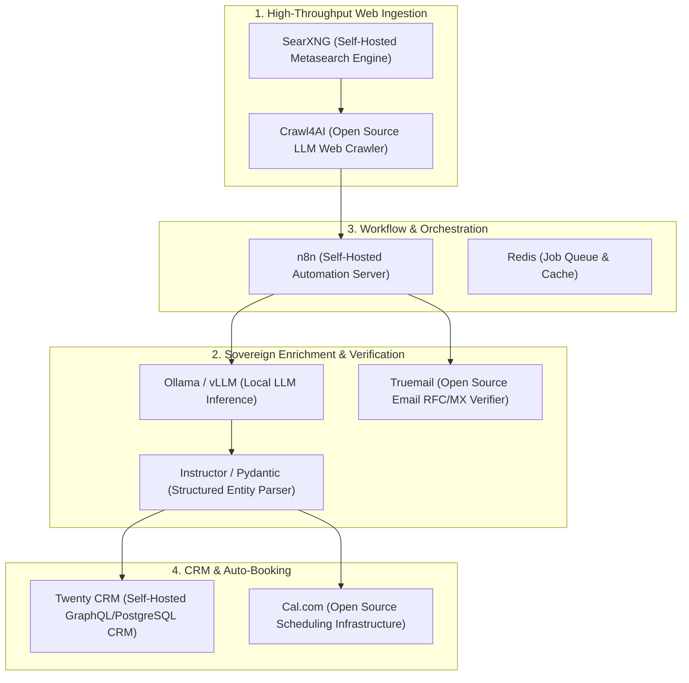
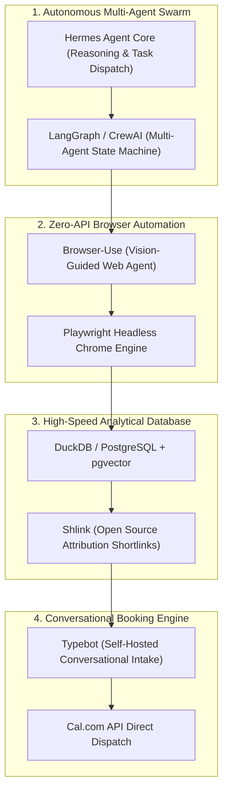

# Tool Stacks Architecture & Comparison — Lead Generator (<60s)

To give production teams full architectural flexibility, Techstarz101 specifies **two distinct open-source technology stacks** for the Lead Generator service:

---

## Stack A: High-Throughput Sovereign Pipeline Stack (Deterministic Orchestration)

Stack A is designed for high-concurrency, deterministic outbound pipelines where speed, strict data schemas, and CRM integration are paramount.

### Component Breakdown
1. **Discovery & Crawling:** **Crawl4AI** (`https://github.com/unclecode/crawl4ai`) + **SearXNG** (`https://github.com/searxng/searxng`).
   - *Why:* Crawl4AI delivers markdown-optimized HTML extraction at 6x speed of raw Playwright, stripping boilerplate and ads.
2. **Orchestration & Workflow:** **n8n Self-Hosted** (`https://github.com/n8n-io/n8n`).
   - *Why:* Visual workflow routing, error handling, rate-limiting, and webhook triggers with zero licensing cost.
3. **Email Verification:** **Truemail** (`https://github.com/truemail-rb/truemail`).
   - *Why:* Deep multi-regex RFC-compliant validation, MX record lookup, DNS tests, and mock SMTP handshake.
4. **Structured Enrichment:** **Ollama / vLLM** + **Instructor Python**.
   - *Why:* Guarantees strict JSON schema conformance without hallucinations, extracting CEO/Founder contacts and custom hooks.
5. **System of Record & Calendar:** **Twenty CRM** (`https://twenty.com`) + **Cal.com** (`https://cal.com`).
   - *Why:* Modern open-source CRM with native GraphQL APIs and self-hosted Cal.com appointment dispatch.

---

## Stack B: Agentic Autonomous Swarm Stack (Adaptive Zero-API RPA)

Stack B is built for complex, dynamic B2B discovery where lead data is locked behind non-standard web forms, multi-step portals, and modern interactive web apps.

### Component Breakdown
1. **Agent Intelligence & Planning:** **Hermes Agent Core** + **LangGraph** (`https://github.com/langchain-ai/langgraph`).
   - *Why:* Manages complex multi-step research loops, retries failing websites, pivots search queries when data is thin.
2. **Zero-API Web Interaction:** **Browser-Use** (`https://github.com/browser-use/browser-use`) + **Playwright**.
   - *Why:* Uses vision and DOM tree analysis to click through pagination, interact with directory search inputs, and extract hidden contact modals.
3. **Analytical Data Lake:** **DuckDB** + **PostgreSQL**.
   - *Why:* Columnar in-memory processing for 250+ leads in sub-second time, with persistent PostgreSQL export.
4. **Attribution & Conversational Booking:** **Shlink** (`https://shlink.io`) + **Typebot** (`https://typebot.io`).
   - *Why:* Self-hosted shortlink generator to track email click-through rates and route leads into an interactive qualification chat that books directly into Cal.com.

---

## Comparison Matrix

| Feature / Dimension | Stack A (Sovereign Pipeline) | Stack B (Agentic Swarm) |
| :--- | :--- | :--- |
| **Primary Strength** | Raw speed (<45s for 250 leads), high concurrency | Adapts to messy, dynamic, protected directories |
| **Compute Footprint** | Low–Medium (runs on standard 4GB–8GB VPS) | Medium–High (GPU recommended for vision browser) |
| **Operational Complexity**| Low (Docker Compose up & run) | Medium (requires agent loop supervision) |
| **CRM Integration** | Native Twenty CRM GraphQL integration | PostgreSQL / DuckDB direct tabular export |
| **Best Used For** | Daily automated lead generation batches | High-value bespoke accounts with deep research |
