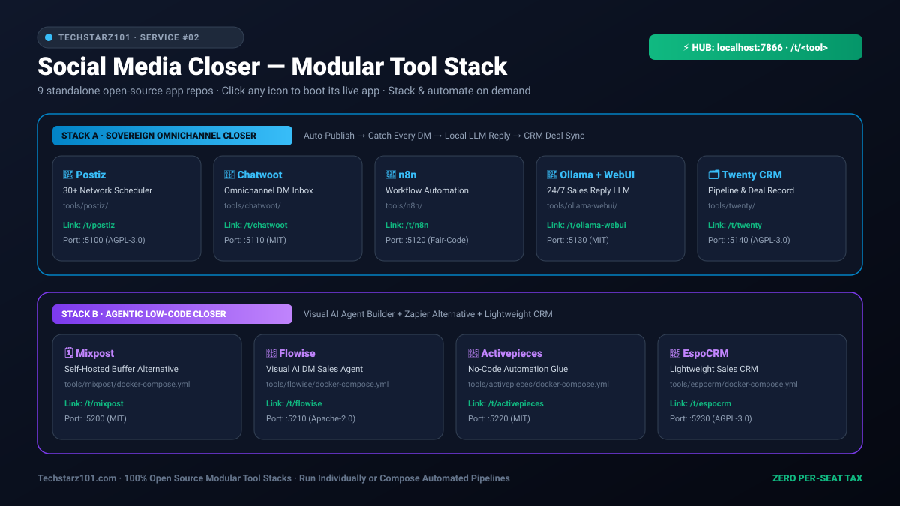

# Techstarz101 Social Media Closer (Auto-Posts & 24/7 DM Sales Replies)

[](http://localhost:7866)
[](docs/STACK_COMPARISON.md)
[](automations/)

> **Every tool in both open-source stacks is built as its own standalone repo** (`tools/<id>/docker-compose.yml`), runs independently on its own port, and has a **dedicated clickable launch link (`http://localhost:7866/t/<id>`)** — while also letting you check any combination of tools to stack and automate them together.

---

## 📊 System Architecture Infographic



---

## 🧩 Click Any Tool Repo Icon to Launch & Open That Individual App

### Stack A — Sovereign Omnichannel Closer (5 Standalone App Repos)

| Click Icon to Launch | Standalone Repo Folder | Dedicated Auto-Launch Link | Direct App URL | Upstream GitHub |
| :---: | :--- | :--- | :--- | :--- |
| [📣 **Postiz**](http://localhost:7866/t/postiz) | [`tools/postiz/`](tools/postiz/) | [`/t/postiz`](http://localhost:7866/t/postiz) | `http://localhost:5100` | [gitroomhq/postiz-app](https://github.com/gitroomhq/postiz-app) |
| [💬 **Chatwoot**](http://localhost:7866/t/chatwoot) | [`tools/chatwoot/`](tools/chatwoot/) | [`/t/chatwoot`](http://localhost:7866/t/chatwoot) | `http://localhost:5110` | [chatwoot/chatwoot](https://github.com/chatwoot/chatwoot) |
| [🔀 **n8n**](http://localhost:7866/t/n8n) | [`tools/n8n/`](tools/n8n/) | [`/t/n8n`](http://localhost:7866/t/n8n) | `http://localhost:5120` | [n8n-io/n8n](https://github.com/n8n-io/n8n) |
| [🧠 **Ollama + Open WebUI**](http://localhost:7866/t/ollama-webui) | [`tools/ollama-webui/`](tools/ollama-webui/) | [`/t/ollama-webui`](http://localhost:7866/t/ollama-webui) | `http://localhost:5130` | [ollama/ollama](https://github.com/ollama/ollama) |
| [🗂️ **Twenty CRM**](http://localhost:7866/t/twenty) | [`tools/twenty/`](tools/twenty/) | [`/t/twenty`](http://localhost:7866/t/twenty) | `http://localhost:5140` | [twentyhq/twenty](https://github.com/twentyhq/twenty) |

### Stack B — Agentic Low-Code Closer (4 Standalone App Repos)

| Click Icon to Launch | Standalone Repo Folder | Dedicated Auto-Launch Link | Direct App URL | Upstream GitHub |
| :---: | :--- | :--- | :--- | :--- |
| [🗓️ **Mixpost**](http://localhost:7866/t/mixpost) | [`tools/mixpost/`](tools/mixpost/) | [`/t/mixpost`](http://localhost:7866/t/mixpost) | `http://localhost:5200/mixpost` | [inovector/mixpost](https://github.com/inovector/mixpost) |
| [🤖 **Flowise**](http://localhost:7866/t/flowise) | [`tools/flowise/`](tools/flowise/) | [`/t/flowise`](http://localhost:7866/t/flowise) | `http://localhost:5210` | [FlowiseAI/Flowise](https://github.com/FlowiseAI/Flowise) |
| [🧩 **Activepieces**](http://localhost:7866/t/activepieces) | [`tools/activepieces/`](tools/activepieces/) | [`/t/activepieces`](http://localhost:7866/t/activepieces) | `http://localhost:5220` | [activepieces/activepieces](https://github.com/activepieces/activepieces) |
| [📇 **EspoCRM**](http://localhost:7866/t/espocrm) | [`tools/espocrm/`](tools/espocrm/) | [`/t/espocrm`](http://localhost:7866/t/espocrm) | `http://localhost:5230` | [espocrm/espocrm](https://github.com/espocrm/espocrm) |

---

## 🚀 Quickstart

```powershell
python techstarz101_services/02_social_media_closer/hub/app.py
```
Open **[http://localhost:7866](http://localhost:7866)** to click individual tool icons, stack & automate selected tools, test the live 24/7 DM closer pipeline, or watch the product feature video.

---

## 🎥 Product Feature Video (MP4)
- **Video:** [video/social_closer_feature.mp4](video/social_closer_feature.mp4) (1080x1080, 30fps, rendered with `character_02_podcast_studio_mic.jpg`).

## 📁 Planning-to-Production Docs & Automations
- 📄 [docs/PRD.md](docs/PRD.md)
- 🏗️ [docs/ARCHITECTURE.md](docs/ARCHITECTURE.md)
- ⚖️ [docs/STACK_COMPARISON.md](docs/STACK_COMPARISON.md)
- 🚢 [docs/DEPLOYMENT.md](docs/DEPLOYMENT.md)
- 🔀 [automations/stack_a_dm_closer.n8n.json](automations/stack_a_dm_closer.n8n.json)
- 🤖 [automations/stack_b_flowise_closer.json](automations/stack_b_flowise_closer.json)
