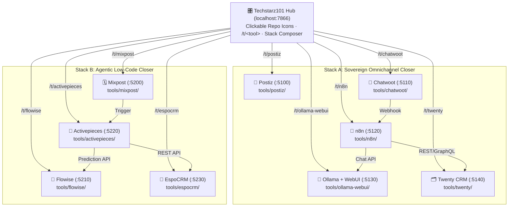

# Production System Architecture — Social Media Closer

**Service ID:** `TS101-SRV-02`  
**Control Plane Hub:** `http://localhost:7866` (`hub/app.py`)  
**Isolation Pattern:** One Docker Compose Project (`ts101-<tool>`) + Dedicated Port per Tool

---

## 1. Modular Standalone + Stackable Topology

---

## 2. Dedicated Per-Tool Link Lifecycle (`/t/<id>`)

1. User clicks a tool's repo icon or opens `http://localhost:7866/t/<id>`.
2. `launch.html` polls `/api/status` and checks Docker engine readiness.
3. If the tool is `stopped`, the hub auto-generates `.env` from `.env.example` (cryptographically random secrets) and runs `docker compose -f tools/<id>/docker-compose.yml up -d`.
4. Live compose logs stream to the browser while the hub probes the tool's HTTP health endpoint.
5. As soon as the app responds (`HTTP < 500`), the browser automatically redirects straight into the live application URL (e.g., `http://localhost:5100`).
