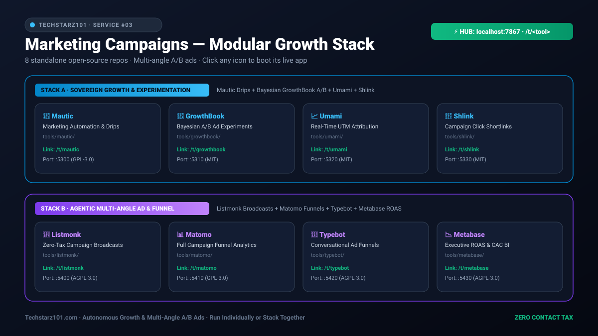

# Techstarz101 Marketing Campaigns (Autonomous Growth & Multi-Angle A/B Ads)

> **8 standalone, click-to-launch open-source marketing repos** across 2 composable growth stacks. Every tool works individually via its dedicated link (`http://localhost:7867/t/<tool>`) or stacked together with pre-built A/B attribution workflows.

---

## 📊 System Architecture Infographic

---

## 🧩 Click Any Tool Repo Icon to Launch & Open That Individual App

### Stack A — Sovereign Growth & Experimentation (4 Standalone Repos)

| Click to Auto-Launch | Standalone Repo Folder | Dedicated Link | Direct App URL | Upstream Repo |
| :---: | :--- | :--- | :--- | :--- |
| [📣 **Mautic**](http://localhost:7867/t/mautic) | [`tools/mautic/`](tools/mautic/) | `/t/mautic` | `http://localhost:5300` | [mautic/mautic](https://github.com/mautic/mautic) |
| [🧪 **GrowthBook**](http://localhost:7867/t/growthbook) | [`tools/growthbook/`](tools/growthbook/) | `/t/growthbook` | `http://localhost:5310` | [growthbook/growthbook](https://github.com/growthbook/growthbook) |
| [📈 **Umami**](http://localhost:7867/t/umami) | [`tools/umami/`](tools/umami/) | `/t/umami` | `http://localhost:5320` | [umami-software/umami](https://github.com/umami-software/umami) |
| [🔗 **Shlink**](http://localhost:7867/t/shlink) | [`tools/shlink/`](tools/shlink/) | `/t/shlink` | `http://localhost:5330` | [shlinkio/shlink](https://github.com/shlinkio/shlink) |

### Stack B — Agentic Multi-Angle Ad & Funnel (4 Standalone Repos)

| Click to Auto-Launch | Standalone Repo Folder | Dedicated Link | Direct App URL | Upstream Repo |
| :---: | :--- | :--- | :--- | :--- |
| [📧 **Listmonk**](http://localhost:7867/t/listmonk) | [`tools/listmonk/`](tools/listmonk/) | `/t/listmonk` | `http://localhost:5400` | [knadh/listmonk](https://github.com/knadh/listmonk) |
| [📊 **Matomo**](http://localhost:7867/t/matomo) | [`tools/matomo/`](tools/matomo/) | `/t/matomo` | `http://localhost:5410` | [matomo-org/matomo](https://github.com/matomo-org/matomo) |
| [💬 **Typebot**](http://localhost:7867/t/typebot) | [`tools/typebot/`](tools/typebot/) | `/t/typebot` | `http://localhost:5420` | [baptisteArno/typebot.io](https://github.com/baptisteArno/typebot.io) |
| [📉 **Metabase**](http://localhost:7867/t/metabase) | [`tools/metabase/`](tools/metabase/) | `/t/metabase` | `http://localhost:5430` | [metabase/metabase](https://github.com/metabase/metabase) |

---

## 🎥 Product Feature Video (MP4)
- **Video:** [video/marketing_campaigns_feature.mp4](video/marketing_campaigns_feature.mp4) (1080x1080, 30fps, rendered with `character_04_penthouse_lounge_tracksuit.jpg`).

## 📁 Planning-to-Production Docs & Automations
- 📄 [docs/PRD.md](docs/PRD.md) · 🏗️ [docs/ARCHITECTURE.md](docs/ARCHITECTURE.md) · ⚖️ [docs/STACK_COMPARISON.md](docs/STACK_COMPARISON.md) · 🚢 [docs/DEPLOYMENT.md](docs/DEPLOYMENT.md)
- 🔀 [automations/stack_a_ab_campaign_router.n8n.json](automations/stack_a_ab_campaign_router.n8n.json) · 💬 [automations/stack_b_funnel_broadcast.json](automations/stack_b_funnel_broadcast.json)
