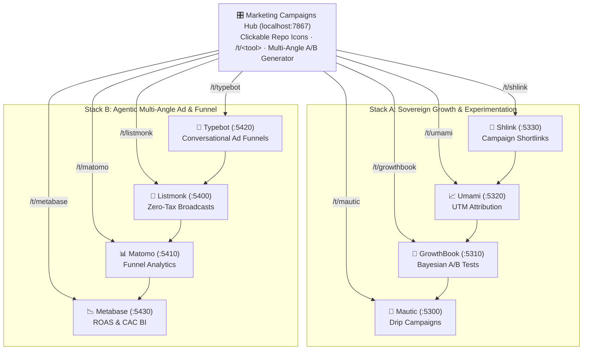

# Production System Architecture — Marketing Campaigns

**Service ID:** `TS101-SRV-03`  
**Hub Control Plane:** `http://localhost:7867` (`hub/app.py`)  
**Standalone Repo Pattern:** One Docker Compose project (`ts101-<tool>`) + dedicated port + `/t/<tool>` link per app.

