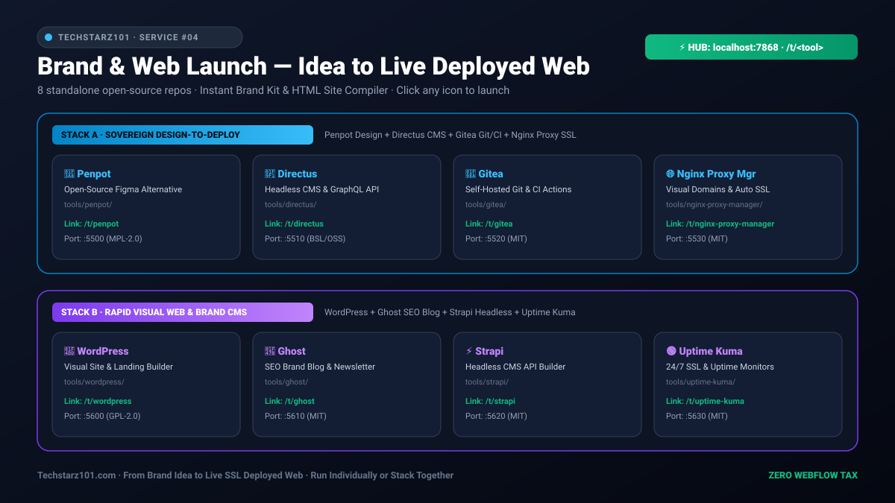

# Techstarz101 Brand & Web Launch (From Initial Idea to Live Deployed Web)

> **8 standalone, click-to-launch open-source brand & web repos** across 2 composable stacks, plus a built-in Brand Kit & Live Deployable HTML Landing Page compiler.

---

## 📊 System Architecture Infographic

---

## 🧩 Click Any Tool Repo Icon to Launch & Open That Individual App

### Stack A — Sovereign Design-to-Deploy (4 Standalone Repos)

| Click to Auto-Launch | Standalone Repo Folder | Dedicated Link | Direct App URL | Upstream Repo |
| :---: | :--- | :--- | :--- | :--- |
| [🎨 **Penpot**](http://localhost:7868/t/penpot) | [`tools/penpot/`](tools/penpot/) | `/t/penpot` | `http://localhost:5500` | [penpot/penpot](https://github.com/penpot/penpot) |
| [🧱 **Directus**](http://localhost:7868/t/directus) | [`tools/directus/`](tools/directus/) | `/t/directus` | `http://localhost:5510` | [directus/directus](https://github.com/directus/directus) |
| [🦊 **Gitea**](http://localhost:7868/t/gitea) | [`tools/gitea/`](tools/gitea/) | `/t/gitea` | `http://localhost:5520` | [go-gitea/gitea](https://github.com/go-gitea/gitea) |
| [🌐 **Nginx Proxy Manager**](http://localhost:7868/t/nginx-proxy-manager) | [`tools/nginx-proxy-manager/`](tools/nginx-proxy-manager/) | `/t/nginx-proxy-manager` | `http://localhost:5530` | [NginxProxyManager](https://github.com/NginxProxyManager/nginx-proxy-manager) |

### Stack B — Rapid Visual Web & Brand CMS (4 Standalone Repos)

| Click to Auto-Launch | Standalone Repo Folder | Dedicated Link | Direct App URL | Upstream Repo |
| :---: | :--- | :--- | :--- | :--- |
| [📝 **WordPress**](http://localhost:7868/t/wordpress) | [`tools/wordpress/`](tools/wordpress/) | `/t/wordpress` | `http://localhost:5600` | [WordPress/WordPress](https://github.com/WordPress/WordPress) |
| [👻 **Ghost**](http://localhost:7868/t/ghost) | [`tools/ghost/`](tools/ghost/) | `/t/ghost` | `http://localhost:5610/ghost` | [TryGhost/Ghost](https://github.com/TryGhost/Ghost) |
| [⚡ **Strapi**](http://localhost:7868/t/strapi) | [`tools/strapi/`](tools/strapi/) | `/t/strapi` | `http://localhost:5620/admin` | [strapi/strapi](https://github.com/strapi/strapi) |
| [🟢 **Uptime Kuma**](http://localhost:7868/t/uptime-kuma) | [`tools/uptime-kuma/`](tools/uptime-kuma/) | `/t/uptime-kuma` | `http://localhost:5630` | [louislam/uptime-kuma](https://github.com/louislam/uptime-kuma) |

---

## 🎥 Product Feature Video (MP4)
- **Video:** [video/brand_web_launch_feature.mp4](video/brand_web_launch_feature.mp4) (1080x1080, 30fps, rendered with `character_01_street_cap_smile.jpg`).

## 📁 Planning-to-Production Docs & Automations
- 📄 [docs/PRD.md](docs/PRD.md) · 🏗️ [docs/ARCHITECTURE.md](docs/ARCHITECTURE.md) · ⚖️ [docs/STACK_COMPARISON.md](docs/STACK_COMPARISON.md) · 🚢 [docs/DEPLOYMENT.md](docs/DEPLOYMENT.md)
- 🔀 [automations/stack_a_git_to_live_deploy.n8n.json](automations/stack_a_git_to_live_deploy.n8n.json) · 🎨 [automations/stack_b_cms_launch_pipeline.json](automations/stack_b_cms_launch_pipeline.json)
