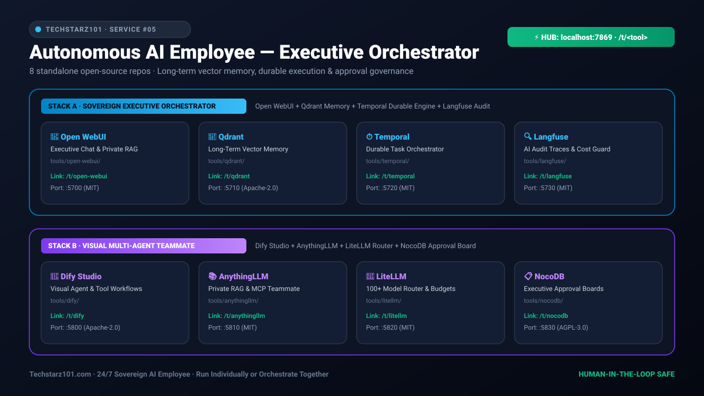

# Techstarz101 Autonomous AI Employee (Full-Stack Teammate & Executive Orchestrator)

> **8 standalone, click-to-launch open-source AI teammate repos** across 2 composable stacks — with long-term vector memory, durable execution, spend caps, and human-in-the-loop approval governance.

---

## 📊 System Architecture Infographic

---

## 🧩 Click Any Tool Repo Icon to Launch & Open That Individual App

### Stack A — Sovereign Executive Orchestrator (4 Standalone Repos)

| Click to Auto-Launch | Standalone Repo Folder | Dedicated Link | Direct App URL | Upstream Repo |
| :---: | :--- | :--- | :--- | :--- |
| [🧠 **Open WebUI**](http://localhost:7869/t/open-webui) | [`tools/open-webui/`](tools/open-webui/) | `/t/open-webui` | `http://localhost:5700` | [open-webui/open-webui](https://github.com/open-webui/open-webui) |
| [🧬 **Qdrant**](http://localhost:7869/t/qdrant) | [`tools/qdrant/`](tools/qdrant/) | `/t/qdrant` | `http://localhost:5710/dashboard` | [qdrant/qdrant](https://github.com/qdrant/qdrant) |
| [⏱️ **Temporal**](http://localhost:7869/t/temporal) | [`tools/temporal/`](tools/temporal/) | `/t/temporal` | `http://localhost:5720` | [temporalio/temporal](https://github.com/temporalio/temporal) |
| [🔍 **Langfuse**](http://localhost:7869/t/langfuse) | [`tools/langfuse/`](tools/langfuse/) | `/t/langfuse` | `http://localhost:5730` | [langfuse/langfuse](https://github.com/langfuse/langfuse) |

### Stack B — Visual Multi-Agent Teammate (4 Standalone Repos)

| Click to Auto-Launch | Standalone Repo Folder | Dedicated Link | Direct App URL | Upstream Repo |
| :---: | :--- | :--- | :--- | :--- |
| [🤖 **Dify Studio**](http://localhost:7869/t/dify) | [`tools/dify/`](tools/dify/) | `/t/dify` | `http://localhost:5800` | [langgenius/dify](https://github.com/langgenius/dify) |
| [📚 **AnythingLLM**](http://localhost:7869/t/anythingllm) | [`tools/anythingllm/`](tools/anythingllm/) | `/t/anythingllm` | `http://localhost:5810` | [Mintplex-Labs/anything-llm](https://github.com/Mintplex-Labs/anything-llm) |
| [🚦 **LiteLLM Gateway**](http://localhost:7869/t/litellm) | [`tools/litellm/`](tools/litellm/) | `/t/litellm` | `http://localhost:5820/ui` | [BerriAI/litellm](https://github.com/BerriAI/litellm) |
| [📋 **NocoDB Board**](http://localhost:7869/t/nocodb) | [`tools/nocodb/`](tools/nocodb/) | `/t/nocodb` | `http://localhost:5830` | [nocodb/nocodb](https://github.com/nocodb/nocodb) |

---

## 🎥 Product Feature Video (MP4)
- **Video:** [video/autonomous_ai_employee_feature.mp4](video/autonomous_ai_employee_feature.mp4) (1080x1080, 30fps, rendered with `character_03_executive_suite_suit.jpg`).

## 📁 Planning-to-Production Docs & Automations
- 📄 [docs/PRD.md](docs/PRD.md) · 🏗️ [docs/ARCHITECTURE.md](docs/ARCHITECTURE.md) · ⚖️ [docs/STACK_COMPARISON.md](docs/STACK_COMPARISON.md) · 🚢 [docs/DEPLOYMENT.md](docs/DEPLOYMENT.md)
- 🔀 [automations/stack_a_executive_briefing.n8n.json](automations/stack_a_executive_briefing.n8n.json) · 📋 [automations/stack_b_agent_approval_loop.json](automations/stack_b_agent_approval_loop.json)
