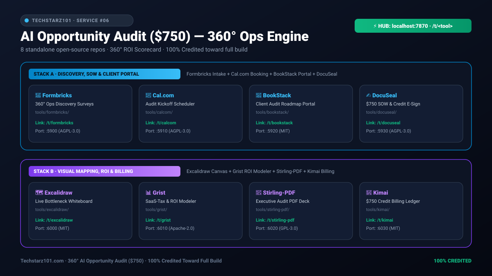

# Techstarz101 AI Opportunity Audit ($750) — 360° Operational Audit & 100% Credited

> **8 standalone, click-to-launch open-source audit delivery repos** across 2 composable stacks, plus a built-in 360° ROI Scorecard & Executive Report Generator.

---

## 📊 System Architecture Infographic

---

## 🧩 Click Any Tool Repo Icon to Launch & Open That Individual App

### Stack A — Discovery, SOW & Client Portal (4 Standalone Repos)

| Click to Auto-Launch | Standalone Repo Folder | Dedicated Link | Direct App URL | Upstream Repo |
| :---: | :--- | :--- | :--- | :--- |
| [📝 **Formbricks**](http://localhost:7870/t/formbricks) | [`tools/formbricks/`](tools/formbricks/) | `/t/formbricks` | `http://localhost:5900` | [formbricks/formbricks](https://github.com/formbricks/formbricks) |
| [📅 **Cal.com**](http://localhost:7870/t/calcom) | [`tools/calcom/`](tools/calcom/) | `/t/calcom` | `http://localhost:5910` | [calcom/cal.com](https://github.com/calcom/cal.com) |
| [📘 **BookStack**](http://localhost:7870/t/bookstack) | [`tools/bookstack/`](tools/bookstack/) | `/t/bookstack` | `http://localhost:5920` | [BookStackApp/BookStack](https://github.com/BookStackApp/BookStack) |
| [✍️ **DocuSeal**](http://localhost:7870/t/docuseal) | [`tools/docuseal/`](tools/docuseal/) | `/t/docuseal` | `http://localhost:5930` | [docusealco/docuseal](https://github.com/docusealco/docuseal) |

### Stack B — Visual Mapping, ROI Modeling & Billing (4 Standalone Repos)

| Click to Auto-Launch | Standalone Repo Folder | Dedicated Link | Direct App URL | Upstream Repo |
| :---: | :--- | :--- | :--- | :--- |
| [🗺️ **Excalidraw**](http://localhost:7870/t/excalidraw) | [`tools/excalidraw/`](tools/excalidraw/) | `/t/excalidraw` | `http://localhost:6000` | [excalidraw/excalidraw](https://github.com/excalidraw/excalidraw) |
| [📊 **Grist**](http://localhost:7870/t/grist) | [`tools/grist/`](tools/grist/) | `/t/grist` | `http://localhost:6010` | [gristlabs/grist-core](https://github.com/gristlabs/grist-core) |
| [📄 **Stirling-PDF**](http://localhost:7870/t/stirling-pdf) | [`tools/stirling-pdf/`](tools/stirling-pdf/) | `/t/stirling-pdf` | `http://localhost:6020` | [Stirling-Tools/Stirling-PDF](https://github.com/Stirling-Tools/Stirling-PDF) |
| [🧾 **Kimai**](http://localhost:7870/t/kimai) | [`tools/kimai/`](tools/kimai/) | `/t/kimai` | `http://localhost:6030` | [kimai/kimai](https://github.com/kimai/kimai) |

---

## 🎥 Product Feature Video (MP4)
- **Video:** [video/ai_opportunity_audit_feature.mp4](video/ai_opportunity_audit_feature.mp4) (1080x1080, 30fps, rendered with `character_02_podcast_studio_mic.jpg`).

## 📁 Planning-to-Production Docs & Automations
- 📄 [docs/PRD.md](docs/PRD.md) · 🏗️ [docs/ARCHITECTURE.md](docs/ARCHITECTURE.md) · ⚖️ [docs/STACK_COMPARISON.md](docs/STACK_COMPARISON.md) · 🚢 [docs/DEPLOYMENT.md](docs/DEPLOYMENT.md)
- 🔀 [automations/stack_a_audit_onboarding.n8n.json](automations/stack_a_audit_onboarding.n8n.json) · 📊 [automations/stack_b_roi_report_delivery.json](automations/stack_b_roi_report_delivery.json)
