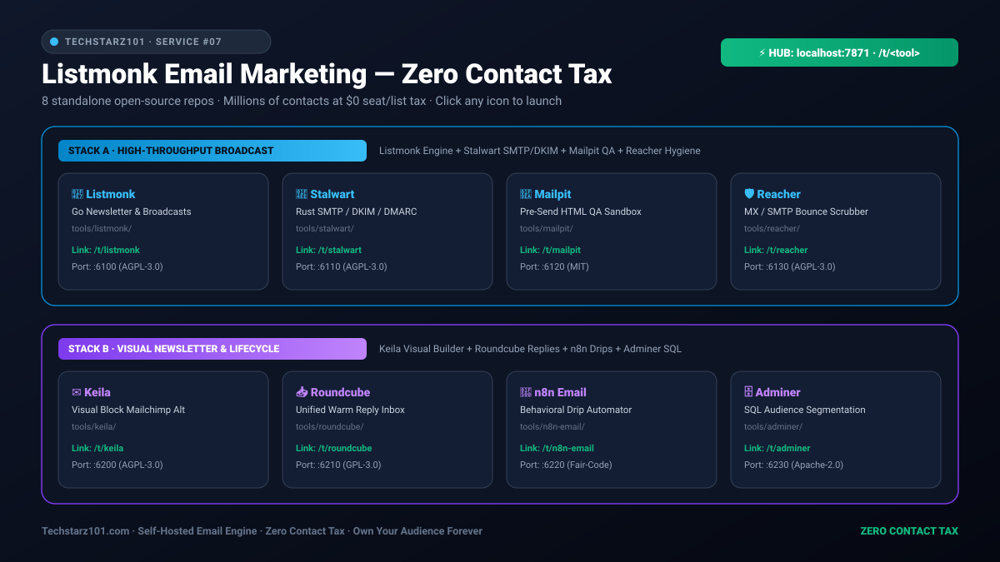

# Techstarz101 Listmonk Email Marketing (Zero Contact Tax)

> **8 standalone, click-to-launch open-source email marketing repos** across 2 composable stacks — zero contact tax, full DKIM/DMARC sovereignty, and pre-send QA.

---

## 📊 System Architecture Infographic

---

## 🧩 Click Any Tool Repo Icon to Launch & Open That Individual App

### Stack A — High-Throughput Sovereign Broadcast (4 Standalone Repos)

| Click to Auto-Launch | Standalone Repo Folder | Dedicated Link | Direct App URL | Upstream Repo |
| :---: | :--- | :--- | :--- | :--- |
| [📧 **Listmonk**](http://localhost:7871/t/listmonk) | [`tools/listmonk/`](tools/listmonk/) | `/t/listmonk` | `http://localhost:6100` | [knadh/listmonk](https://github.com/knadh/listmonk) |
| [📮 **Stalwart Mail**](http://localhost:7871/t/stalwart) | [`tools/stalwart/`](tools/stalwart/) | `/t/stalwart` | `http://localhost:6110` | [stalwartlabs/mail-server](https://github.com/stalwartlabs/mail-server) |
| [🧪 **Mailpit QA**](http://localhost:7871/t/mailpit) | [`tools/mailpit/`](tools/mailpit/) | `/t/mailpit` | `http://localhost:6120` | [axllent/mailpit](https://github.com/axllent/mailpit) |
| [🛡️ **Reacher Verifier**](http://localhost:7871/t/reacher) | [`tools/reacher/`](tools/reacher/) | `/t/reacher` | `http://localhost:6130` | [reacherhq/check-if-email-exists](https://github.com/reacherhq/check-if-email-exists) |

### Stack B — Visual Newsletter & Behavioral Lifecycle (4 Standalone Repos)

| Click to Auto-Launch | Standalone Repo Folder | Dedicated Link | Direct App URL | Upstream Repo |
| :---: | :--- | :--- | :--- | :--- |
| [✉️ **Keila**](http://localhost:7871/t/keila) | [`tools/keila/`](tools/keila/) | `/t/keila` | `http://localhost:6200` | [pentacent/keila](https://github.com/pentacent/keila) |
| [📥 **Roundcube**](http://localhost:7871/t/roundcube) | [`tools/roundcube/`](tools/roundcube/) | `/t/roundcube` | `http://localhost:6210` | [roundcube/roundcubemail](https://github.com/roundcube/roundcubemail) |
| [🔀 **n8n Email**](http://localhost:7871/t/n8n-email) | [`tools/n8n-email/`](tools/n8n-email/) | `/t/n8n-email` | `http://localhost:6220` | [n8n-io/n8n](https://github.com/n8n-io/n8n) |
| [🗄️ **Adminer SQL**](http://localhost:7871/t/adminer) | [`tools/adminer/`](tools/adminer/) | `/t/adminer` | `http://localhost:6230` | [vrana/adminer](https://github.com/vrana/adminer) |

---

## 🎥 Product Feature Video (MP4)
- **Video:** [video/listmonk_email_feature.mp4](video/listmonk_email_feature.mp4) (1080x1080, 30fps, rendered with `character_04_penthouse_lounge_tracksuit.jpg`).

## 📁 Planning-to-Production Docs & Automations
- 📄 [docs/PRD.md](docs/PRD.md) · 🏗️ [docs/ARCHITECTURE.md](docs/ARCHITECTURE.md) · ⚖️ [docs/STACK_COMPARISON.md](docs/STACK_COMPARISON.md) · 🚢 [docs/DEPLOYMENT.md](docs/DEPLOYMENT.md)
- 🔀 [automations/stack_a_listmonk_hygiene_blast.n8n.json](automations/stack_a_listmonk_hygiene_blast.n8n.json) · ✉️ [automations/stack_b_keila_reply_router.json](automations/stack_b_keila_reply_router.json)
