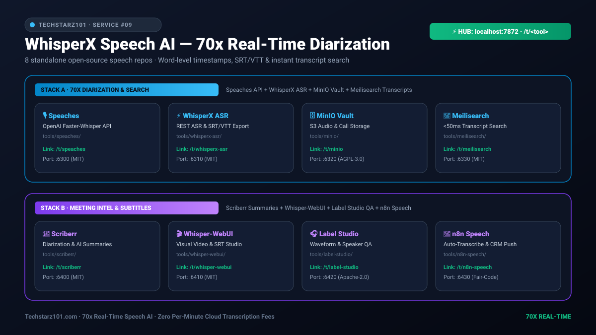

# Techstarz101 WhisperX Speech AI (70x Real-Time Diarization & Timestamps)

> **8 standalone, click-to-launch open-source speech AI repos** across 2 composable stacks — 70x real-time diarization, word-level timestamps, SRT/VTT subtitles, and sub-50ms transcript search.

---

## 📊 System Architecture Infographic

---

## 🧩 Click Any Tool Repo Icon to Launch & Open That Individual App

### Stack A — 70x Real-Time Diarization & Search (4 Standalone Repos)

| Click to Auto-Launch | Standalone Repo Folder | Dedicated Link | Direct App URL | Upstream Repo |
| :---: | :--- | :--- | :--- | :--- |
| [🎙️ **Speaches**](http://localhost:7872/t/speaches) | [`tools/speaches/`](tools/speaches/) | `/t/speaches` | `http://localhost:6300/docs` | [speaches-ai/speaches](https://github.com/speaches-ai/speaches) |
| [⚡ **WhisperX ASR**](http://localhost:7872/t/whisperx-asr) | [`tools/whisperx-asr/`](tools/whisperx-asr/) | `/t/whisperx-asr` | `http://localhost:6310/docs` | [ahmetoner/whisper-asr-webservice](https://github.com/ahmetoner/whisper-asr-webservice) |
| [🗄️ **MinIO Vault**](http://localhost:7872/t/minio) | [`tools/minio/`](tools/minio/) | `/t/minio` | `http://localhost:6320` | [minio/minio](https://github.com/minio/minio) |
| [🔎 **Meilisearch**](http://localhost:7872/t/meilisearch) | [`tools/meilisearch/`](tools/meilisearch/) | `/t/meilisearch` | `http://localhost:6330` | [meilisearch/meilisearch](https://github.com/meilisearch/meilisearch) |

### Stack B — Meeting Intelligence & Subtitle Studio (4 Standalone Repos)

| Click to Auto-Launch | Standalone Repo Folder | Dedicated Link | Direct App URL | Upstream Repo |
| :---: | :--- | :--- | :--- | :--- |
| [📝 **Scriberr**](http://localhost:7872/t/scriberr) | [`tools/scriberr/`](tools/scriberr/) | `/t/scriberr` | `http://localhost:6400` | [rishikanthc/Scriberr](https://github.com/rishikanthc/Scriberr) |
| [🎬 **Whisper-WebUI**](http://localhost:7872/t/whisper-webui) | [`tools/whisper-webui/`](tools/whisper-webui/) | `/t/whisper-webui` | `http://localhost:6410` | [jhj0517/Whisper-WebUI](https://github.com/jhj0517/Whisper-WebUI) |
| [🎧 **Label Studio**](http://localhost:7872/t/label-studio) | [`tools/label-studio/`](tools/label-studio/) | `/t/label-studio` | `http://localhost:6420` | [HumanSignal/label-studio](https://github.com/HumanSignal/label-studio) |
| [🔀 **n8n Speech**](http://localhost:7872/t/n8n-speech) | [`tools/n8n-speech/`](tools/n8n-speech/) | `/t/n8n-speech` | `http://localhost:6430` | [n8n-io/n8n](https://github.com/n8n-io/n8n) |

---

## 🎥 Product Feature Video (MP4)
- **Video:** [video/whisperx_speech_ai_feature.mp4](video/whisperx_speech_ai_feature.mp4) (1080x1080, 30fps, rendered with `character_02_podcast_studio_mic.jpg`).

## 📁 Planning-to-Production Docs & Automations
- 📄 [docs/PRD.md](docs/PRD.md) · 🏗️ [docs/ARCHITECTURE.md](docs/ARCHITECTURE.md) · ⚖️ [docs/STACK_COMPARISON.md](docs/STACK_COMPARISON.md) · 🚢 [docs/DEPLOYMENT.md](docs/DEPLOYMENT.md)
- 🔀 [automations/stack_a_audio_to_search_index.n8n.json](automations/stack_a_audio_to_search_index.n8n.json) · 📝 [automations/stack_b_meeting_summary_pipeline.json](automations/stack_b_meeting_summary_pipeline.json)
