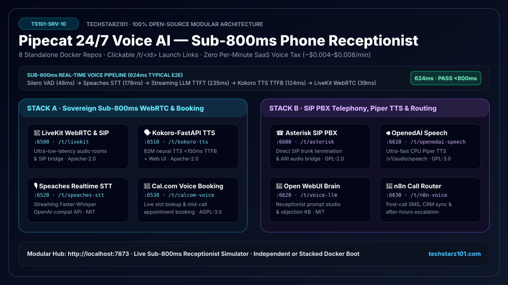

# Service #10: Pipecat 24/7 Voice AI (`TS101-SRV-10`)

**Sub-800ms autonomous phone receptionist, real-time appointment booking, and SIP/WebRTC voice routing — 100% open-source, self-hosted, and zero per-minute vendor tax.**



## Quick Start

```bash
python hub/app.py
# Open http://localhost:7873
```

Every tool in **Stack A** and **Stack B** lives in its own standalone Docker Compose repository under `tools/<id>/`. Click any repo icon in the Modular Hub (or visit its dedicated `/t/<id>` URL) to auto-generate `.env` secrets, boot that container independently, and redirect straight into the live app.

---

## Tool Stacks & Dedicated Launch Links

### Stack A — Sovereign Sub-800ms WebRTC Voice & Booking (`:6500`–`:6530`)
| Tool | Standalone Port | Hub Launch Link | Role | License |
| --- | --- | --- | --- | --- |
| **LiveKit WebRTC & SIP** | `:6500` | `http://localhost:7873/t/livekit` | Ultra-low-latency WebRTC & SIP audio transport for Pipecat | Apache-2.0 |
| **Kokoro-FastAPI TTS** | `:6510` | `http://localhost:7873/t/kokoro-tts` | 82M neural TTS with `<150ms` TTFB + Web UI | Apache-2.0 |
| **Speaches Realtime STT** | `:6520` | `http://localhost:7873/t/speaches-stt` | Streaming Faster-Whisper OpenAI-compatible STT | MIT |
| **Cal.com Voice Booking** | `:6530` | `http://localhost:7873/t/calcom-voice` | Live calendar slot lookup & mid-call appointment booking | AGPL-3.0 |

### Stack B — SIP PBX Telephony, CPU Piper TTS & Call Routing (`:6600`–`:6630`)
| Tool | Standalone Port | Hub Launch Link | Role | License |
| --- | --- | --- | --- | --- |
| **Asterisk SIP PBX** | `:6600` | `http://localhost:7873/t/asterisk` | Direct SIP phone trunk termination + ARI audio bridge | GPL-2.0 |
| **OpenedAI Speech (Piper)** | `:6610` | `http://localhost:7873/t/openedai-speech` | Drop-in OpenAI `/v1/audio/speech` on CPU-only VPS nodes | GPL-3.0 |
| **Open WebUI Voice Brain** | `:6620` | `http://localhost:7873/t/voice-llm` | Local LLM receptionist prompt studio & objection KB | MIT |
| **n8n Call Router** | `:6630` | `http://localhost:7873/t/n8n-voice` | Post-call SMS confirmations, Cal.com webhooks & CRM sync | Sustainable Use |

---

## Included Assets
- **Live Sub-800ms Phone Receptionist Simulator:** Built directly into `http://localhost:7873` (`POST /api/voice/simulate-turn`) with per-stage latency profiling (VAD → STT → LLM → TTS → WebRTC) and browser speech playback.
- **Automations:** [`automations/stack_a_pipecat_call_booking.n8n.json`](automations/stack_a_pipecat_call_booking.n8n.json) and [`automations/stack_b_asterisk_afterhours_router.json`](automations/stack_b_asterisk_afterhours_router.json).
- **Documentation:** [`docs/PRD.md`](docs/PRD.md) · [`docs/ARCHITECTURE.md`](docs/ARCHITECTURE.md) · [`docs/STACK_COMPARISON.md`](docs/STACK_COMPARISON.md) · [`docs/DEPLOYMENT.md`](docs/DEPLOYMENT.md).
- **Product Feature Video:** [`video/pipecat_voice_ai_feature.mp4`](video/pipecat_voice_ai_feature.mp4).
