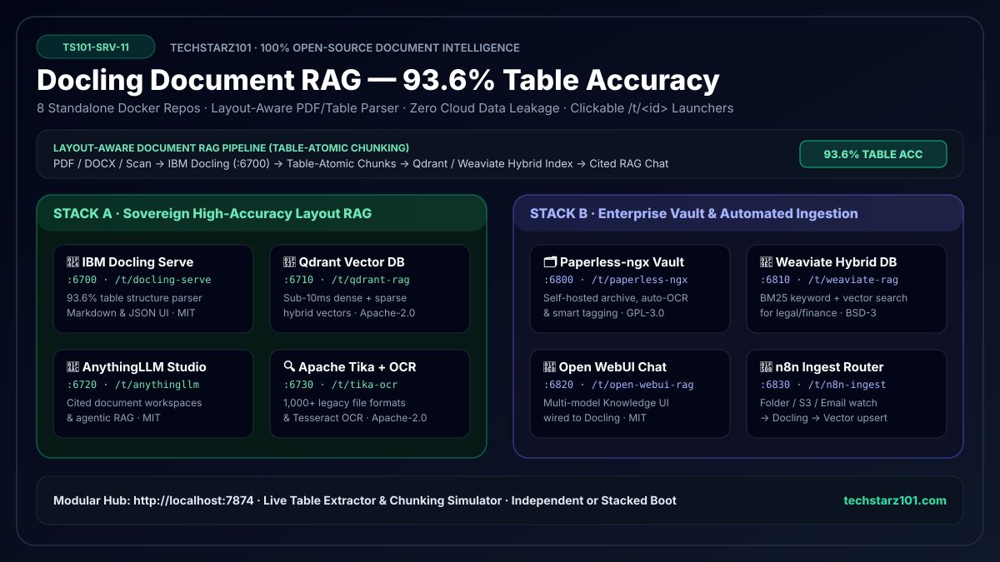

# Service #11: Docling Document RAG (`TS101-SRV-11`)

**93.6% table structure accuracy, layout-aware PDF/DOCX/PPTX parsing, and hybrid vector + BM25 document intelligence — 100% open-source and self-hosted.**



## Quick Start

```bash
python hub/app.py
# Open http://localhost:7874
```

Every tool in **Stack A** and **Stack B** lives in its own standalone Docker Compose repository under `tools/<id>/`. Click any repo icon in the Modular Hub (or visit its dedicated `/t/<id>` URL) to auto-generate `.env` secrets, boot that container independently, and redirect straight into the live app.

---

## Tool Stacks & Dedicated Launch Links

### Stack A — Sovereign High-Accuracy Layout RAG (`:6700`–`:6730`)
| Tool | Standalone Port | Hub Launch Link | Role | License |
| --- | --- | --- | --- | --- |
| **IBM Docling Serve** | `:6700` | `http://localhost:7874/t/docling-serve` | Layout-aware PDF/DOCX/PPTX parser with 93.6% table accuracy & UI | MIT |
| **Qdrant Vector DB** | `:6710` | `http://localhost:7874/t/qdrant-rag` | Sub-10ms dense + sparse hybrid vector database + Dashboard | Apache-2.0 |
| **AnythingLLM RAG Studio** | `:6720` | `http://localhost:7874/t/anythingllm` | Turnkey document chat workspace with page citations & agent skills | MIT |
| **Apache Tika + Tesseract** | `:6730` | `http://localhost:7874/t/tika-ocr` | Fallback parser & OCR for 1,000+ legacy Office/email formats | Apache-2.0 |

### Stack B — Enterprise Document Vault & Automated Ingestion (`:6800`–`:6830`)
| Tool | Standalone Port | Hub Launch Link | Role | License |
| --- | --- | --- | --- | --- |
| **Paperless-ngx Vault** | `:6800` | `http://localhost:7874/t/paperless-ngx` | Self-hosted document archive with auto-OCR, tagging & full-text search | GPL-3.0 |
| **Weaviate Hybrid Search** | `:6810` | `http://localhost:7874/t/weaviate-rag` | Hybrid BM25 keyword + dense vector search for legal/financial RAG | BSD-3-Clause |
| **Open WebUI Doc Chat** | `:6820` | `http://localhost:7874/t/open-webui-rag` | Multi-model Knowledge UI pre-configured for IBM Docling Serve | MIT |
| **n8n Document Pipeline** | `:6830` | `http://localhost:7874/t/n8n-ingest` | Automated folder/S3/email → Docling → Vector DB ingestion orchestrator | Sustainable Use |

---

## Included Assets
- **Live Layout-Aware Table Extractor & RAG Chunking Simulator:** Built directly into `http://localhost:7874` (`POST /api/docling/parse-and-chunk`).
- **Automations:** [`automations/stack_a_docling_qdrant_ingest.n8n.json`](automations/stack_a_docling_qdrant_ingest.n8n.json) and [`automations/stack_b_paperless_weaviate_sync.n8n.json`](automations/stack_b_paperless_weaviate_sync.n8n.json).
- **Documentation:** [`docs/PRD.md`](docs/PRD.md) · [`docs/ARCHITECTURE.md`](docs/ARCHITECTURE.md) · [`docs/STACK_COMPARISON.md`](docs/STACK_COMPARISON.md) · [`docs/DEPLOYMENT.md`](docs/DEPLOYMENT.md).
- **Product Feature Video:** [`video/docling_document_rag_feature.mp4`](video/docling_document_rag_feature.mp4).
