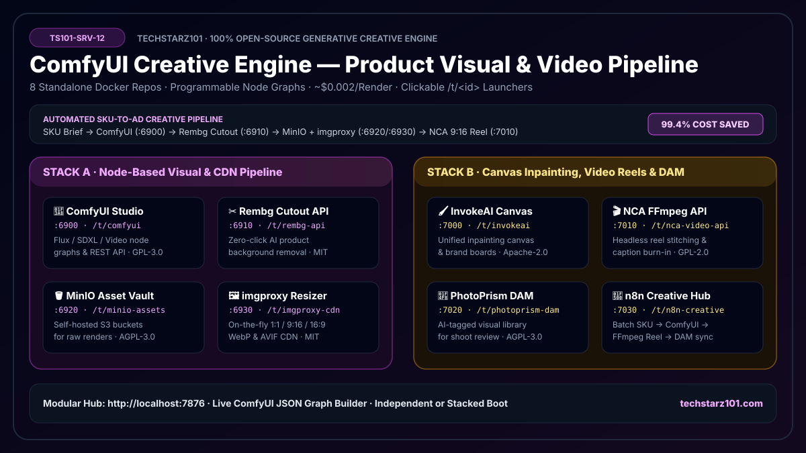

# Service #12: ComfyUI Creative Engine (`TS101-SRV-12`)

**Automated product visual shoots, background cutouts, multi-aspect ad variants, and 9:16 video reel assembly — 100% open-source and self-hosted at ~\$0.002/render.**



## Quick Start

```bash
python hub/app.py
# Open http://localhost:7876
```

Every tool in **Stack A** and **Stack B** lives in its own standalone Docker Compose repository under `tools/<id>/`. Click any repo icon in the Modular Hub (or visit its dedicated `/t/<id>` URL) to auto-generate `.env` secrets, boot that container independently, and redirect straight into the live app.

---

## Tool Stacks & Dedicated Launch Links

### Stack A — Node-Based Generative Product Visual & Video Studio (`:6900`–`:6930`)
| Tool | Standalone Port | Hub Launch Link | Role | License |
| --- | --- | --- | --- | --- |
| **ComfyUI Node Studio** | `:6900` | `http://localhost:7876/t/comfyui` | Programmable Flux/SDXL & AI video node-graph studio + REST API | GPL-3.0 |
| **Rembg Cutout API** | `:6910` | `http://localhost:7876/t/rembg-api` | Zero-click AI product background removal server & web UI | MIT |
| **MinIO Creative Vault** | `:6920` | `http://localhost:7876/t/minio-assets` | Self-hosted S3-compatible asset storage & bucket console | AGPL-3.0 |
| **imgproxy Ad Resizer** | `:6930` | `http://localhost:7876/t/imgproxy-cdn` | Ultra-fast on-the-fly 1:1 / 9:16 / 16:9 WebP/AVIF processor | MIT |

### Stack B — Canvas Inpainting, Headless Video Assembly & Batch DAM (`:7000`–`:7030`)
| Tool | Standalone Port | Hub Launch Link | Role | License |
| --- | --- | --- | --- | --- |
| **InvokeAI Infinite Canvas** | `:7000` | `http://localhost:7876/t/invokeai` | Unified canvas for brand retouching, inpainting & ControlNet | Apache-2.0 |
| **NCA FFmpeg Video API** | `:7010` | `http://localhost:7876/t/nca-video-api` | Headless FFmpeg REST API for reel stitching & caption burn-in | GPL-2.0 |
| **PhotoPrism Visual DAM** | `:7020` | `http://localhost:7876/t/photoprism-dam` | AI-tagged digital asset manager for reviewing product shoots | AGPL-3.0 |
| **n8n Creative Orchestrator** | `:7030` | `http://localhost:7876/t/n8n-creative` | Batch SKU → ComfyUI → Rembg → FFmpeg Reel automation engine | Sustainable Use |

---

## Included Assets
- **Live ComfyUI API Workflow Graph Builder:** Built directly into `http://localhost:7876` (`POST /api/creative/generate-workflow`) with downloadable JSON ready for `POST :6900/prompt`.
- **Automations:** [`automations/stack_a_comfyui_product_batch.n8n.json`](automations/stack_a_comfyui_product_batch.n8n.json) and [`automations/stack_b_reel_assembly_dam.n8n.json`](automations/stack_b_reel_assembly_dam.n8n.json).
- **Documentation:** [`docs/PRD.md`](docs/PRD.md) · [`docs/ARCHITECTURE.md`](docs/ARCHITECTURE.md) · [`docs/STACK_COMPARISON.md`](docs/STACK_COMPARISON.md) · [`docs/DEPLOYMENT.md`](docs/DEPLOYMENT.md).
- **Product Feature Video:** [`video/comfyui_creative_engine_feature.mp4`](video/comfyui_creative_engine_feature.mp4).
