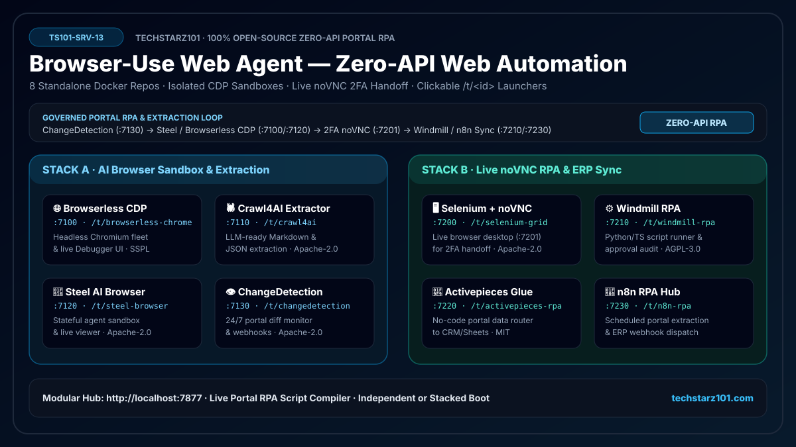

# Service #13: Browser-Use Web Agent (`TS101-SRV-13`)

**Zero-API web automation, legacy portal RPA, structured extraction, and live noVNC human-in-the-loop 2FA handoff — 100% open-source and self-hosted.**



## Quick Start

```bash
python hub/app.py
# Open http://localhost:7877
```

Every tool in **Stack A** and **Stack B** lives in its own standalone Docker Compose repository under `tools/<id>/`. Click any repo icon in the Modular Hub (or visit its dedicated `/t/<id>` URL) to auto-generate `.env` secrets, boot that container independently, and redirect straight into the live app.

---

## Tool Stacks & Dedicated Launch Links

### Stack A — AI Browser Sandbox, CDP Fleet & Structured Extraction (`:7100`–`:7130`)
| Tool | Standalone Port | Hub Launch Link | Role | License |
| --- | --- | --- | --- | --- |
| **Browserless Chromium CDP** | `:7100` | `http://localhost:7877/t/browserless-chrome` | Headless Chromium fleet with CDP & live Debugger UI | SSPL-1.0 |
| **Crawl4AI Extractor** | `:7110` | `http://localhost:7877/t/crawl4ai` | LLM-ready web crawler outputting Markdown & JSON | Apache-2.0 |
| **Steel AI Browser Sandbox** | `:7120` | `http://localhost:7877/t/steel-browser` | Stateful AI browser sandbox with persistent cookies & live viewer | Apache-2.0 |
| **ChangeDetection Monitor** | `:7130` | `http://localhost:7877/t/changedetection` | 24/7 portal & pricing diff monitor with webhook alerts | Apache-2.0 |

### Stack B — Live noVNC Portal RPA, Script Runner & ERP Sync (`:7200`–`:7230`)
| Tool | Standalone Port | Hub Launch Link | Role | License |
| --- | --- | --- | --- | --- |
| **Selenium + Live noVNC** | `:7200` / `:7201` | `http://localhost:7877/t/selenium-grid` | Interactive Chromium RPA with live desktop stream for 2FA | Apache-2.0 |
| **Windmill RPA Runner** | `:7210` | `http://localhost:7877/t/windmill-rpa` | High-speed Python/TS RPA scheduler with approval audit logs | AGPL-3.0 |
| **Activepieces RPA Glue** | `:7220` | `http://localhost:7877/t/activepieces-rpa` | MIT-licensed no-code portal data router to CRMs & Sheets | MIT |
| **n8n Portal Orchestrator** | `:7230` | `http://localhost:7877/t/n8n-rpa` | Scheduled portal extraction & ERP webhook orchestrator | Sustainable Use |

---

## Included Assets
- **Live Portal RPA Playbook & Python Script Compiler:** Built directly into `http://localhost:7877` (`POST /api/rpa/compile-playbook`).
- **Automations:** [`automations/stack_a_portal_extract_sync.n8n.json`](automations/stack_a_portal_extract_sync.n8n.json) and [`automations/stack_b_changedetection_rpa_trigger.n8n.json`](automations/stack_b_changedetection_rpa_trigger.n8n.json).
- **Documentation:** [`docs/PRD.md`](docs/PRD.md) · [`docs/ARCHITECTURE.md`](docs/ARCHITECTURE.md) · [`docs/STACK_COMPARISON.md`](docs/STACK_COMPARISON.md) · [`docs/DEPLOYMENT.md`](docs/DEPLOYMENT.md).
- **Product Feature Video:** [`video/browser_use_web_agent_feature.mp4`](video/browser_use_web_agent_feature.mp4).
