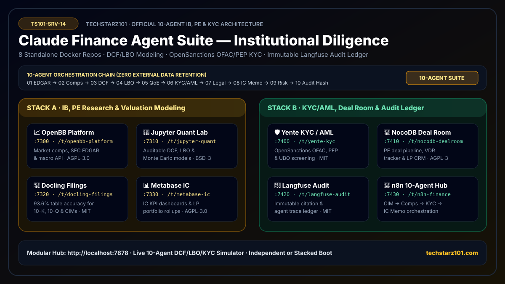

# Service #14: Claude Finance Agent Suite (`TS101-SRV-14`)

**Official 10-agent Investment Banking (IB), Private Equity (PE) & KYC/AML architecture — 100% open-source, self-hosted, and backed by immutable citation audit logs.**



## Quick Start

```bash
python hub/app.py
# Open http://localhost:7878
```

Every tool in **Stack A** and **Stack B** lives in its own standalone Docker Compose repository under `tools/<id>/`. Click any repo icon in the Modular Hub (or visit its dedicated `/t/<id>` URL) to auto-generate `.env` secrets, boot that container independently, and redirect straight into the live app.

---

## Tool Stacks & Dedicated Launch Links

### Stack A — Investment Banking, PE Research & Valuation Modeling (`:7300`–`:7330`)
| Tool | Standalone Port | Hub Launch Link | Role | License |
| --- | --- | --- | --- | --- |
| **OpenBB Financial API** | `:7300` | `http://localhost:7878/t/openbb-platform` | Market data, SEC EDGAR filings, comps & macro REST API | AGPL-3.0 |
| **Jupyter Quant & LBO Lab** | `:7310` | `http://localhost:7878/t/jupyter-quant` | Reproducible Python DCF, LBO & Monte Carlo models | BSD-3-Clause |
| **Docling 10-K / CIM Parser** | `:7320` | `http://localhost:7878/t/docling-filings` | 93.6% table-accuracy PDF parser for 10-Ks, CIMs & QoE | MIT |
| **Metabase IC Dashboards** | `:7330` | `http://localhost:7878/t/metabase-ic` | Investment Committee KPI dashboards & portfolio rollups | AGPL-3.0 |

### Stack B — KYC/AML Screening, Deal Room & 10-Agent Audit Governance (`:7400`–`:7430`)
| Tool | Standalone Port | Hub Launch Link | Role | License |
| --- | --- | --- | --- | --- |
| **OpenSanctions Yente KYC** | `:7400` | `http://localhost:7878/t/yente-kyc` | Real-time OFAC, EU/UN sanctions, PEP & UBO screening API | MIT |
| **NocoDB PE Deal Room** | `:7410` | `http://localhost:7878/t/nocodb-dealroom` | Self-hosted IB/PE deal pipeline, VDR diligence & LP CRM | AGPL-3.0 |
| **Langfuse Agent Audit** | `:7420` | `http://localhost:7878/t/langfuse-audit` | Immutable LLM trace, citation lineage & governance ledger | MIT |
| **n8n 10-Agent Orchestrator** | `:7430` | `http://localhost:7878/t/n8n-finance` | Multi-agent CIM-to-IC-Memo & KYC workflow orchestrator | Sustainable Use |

---

## Included Assets
- **Live 10-Agent IB / PE / KYC Simulator:** Built directly into `http://localhost:7878` (`POST /api/finance/run-10-agents`) with real DCF, 5-year LBO MOIC/IRR, QoE margin, and OFAC/PEP screening outputs + downloadable IC JSON brief.
- **Automations:** [`automations/stack_a_10agent_ic_memo.n8n.json`](automations/stack_a_10agent_ic_memo.n8n.json) and [`automations/stack_b_kyc_aml_dealroom.n8n.json`](automations/stack_b_kyc_aml_dealroom.n8n.json).
- **Documentation:** [`docs/PRD.md`](docs/PRD.md) · [`docs/ARCHITECTURE.md`](docs/ARCHITECTURE.md) · [`docs/STACK_COMPARISON.md`](docs/STACK_COMPARISON.md) · [`docs/DEPLOYMENT.md`](docs/DEPLOYMENT.md).
- **Product Feature Video:** [`video/claude_finance_agent_suite_feature.mp4`](video/claude_finance_agent_suite_feature.mp4).
