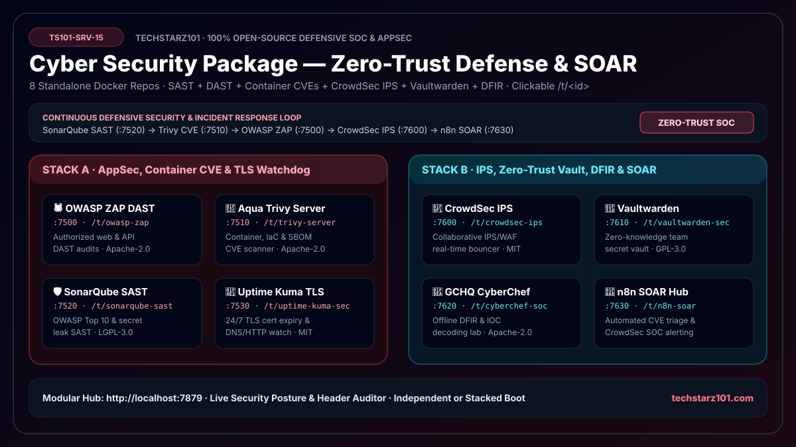

# Service #15: Cyber Security Package (`TS101-SRV-15`)

**100% open-source defensive security suite — SAST, authorized DAST, container CVE scanning, collaborative IPS, Zero-Trust secret vault, offline DFIR, and SOAR alerting.**



## Quick Start

```bash
python hub/app.py
# Open http://localhost:7879
```

Every tool in **Stack A** and **Stack B** lives in its own standalone Docker Compose repository under `tools/<id>/`. Click any repo icon in the Modular Hub (or visit its dedicated `/t/<id>` URL) to auto-generate `.env` secrets, boot that container independently, and redirect straight into the live app.

---

## Tool Stacks & Dedicated Launch Links

### Stack A — AppSec, Container CVE & Certificate Watchdog (`:7500`–`:7530`)
| Tool | Standalone Port | Hub Launch Link | Role | License |
| --- | --- | --- | --- | --- |
| **OWASP ZAP DAST** | `:7500` | `http://localhost:7879/t/owasp-zap` | Authorized web & API vulnerability scanner + WebSwing UI | Apache-2.0 |
| **Aqua Trivy CVE Server** | `:7510` | `http://localhost:7879/t/trivy-server` | Container image, IaC & SBOM vulnerability scanning server | Apache-2.0 |
| **SonarQube SAST** | `:7520` | `http://localhost:7879/t/sonarqube-sast` | Static code security (OWASP Top 10 & secret leak) analyzer | LGPL-3.0 |
| **Uptime Kuma TLS Watch** | `:7530` | `http://localhost:7879/t/uptime-kuma-sec` | 24/7 SSL/TLS certificate expiry, DNS & HTTP monitor | MIT |

### Stack B — Defensive IPS, Zero-Knowledge Vault, DFIR & SOAR (`:7600`–`:7630`)
| Tool | Standalone Port | Hub Launch Link | Role | License |
| --- | --- | --- | --- | --- |
| **CrowdSec IPS & LAPI** | `:7600` | `http://localhost:7879/t/crowdsec-ips` | Collaborative intrusion prevention & brute-force bouncer | MIT |
| **Vaultwarden Zero-Trust** | `:7610` | `http://localhost:7879/t/vaultwarden-sec` | Self-hosted zero-knowledge encrypted secret & 2FA vault | GPL-3.0 |
| **GCHQ CyberChef SOC** | `:7620` | `http://localhost:7879/t/cyberchef-soc` | Offline DFIR & SOC workbench for decoding IOCs & logs | Apache-2.0 |
| **n8n SOAR Playbooks** | `:7630` | `http://localhost:7879/t/n8n-soar` | Automated CVE triage & CrowdSec incident escalation | Sustainable Use |

---

## Included Assets
- **Live Defensive Security Posture Auditor:** Built directly into `http://localhost:7879` (`POST /api/sec/audit-posture`) — inspects pasted HTTP headers, Nginx configs, or Docker Compose files for missing security headers, exposed secrets, and privileged containers, returning a grade, remediation list, and copy-paste Nginx hardening snippet.
- **SOAR Automations:** [`automations/stack_a_cve_triage_soar.n8n.json`](automations/stack_a_cve_triage_soar.n8n.json) and [`automations/stack_b_crowdsec_incident_alert.n8n.json`](automations/stack_b_crowdsec_incident_alert.n8n.json).
- **Documentation:** [`docs/PRD.md`](docs/PRD.md) · [`docs/ARCHITECTURE.md`](docs/ARCHITECTURE.md) · [`docs/STACK_COMPARISON.md`](docs/STACK_COMPARISON.md) · [`docs/DEPLOYMENT.md`](docs/DEPLOYMENT.md).
- **Product Feature Video:** [`video/cyber_security_package_feature.mp4`](video/cyber_security_package_feature.mp4).
